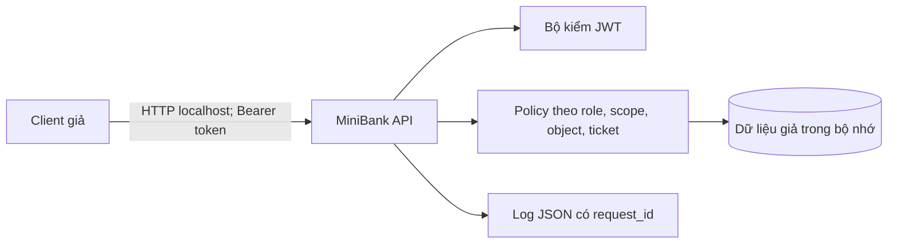

# Mô hình đe dọa và luồng dữ liệu

Ranh giới tin cậy: client/API; token/API; API/dữ liệu; API/log. Mỗi request phải qua kiểm token, quyền chức năng, quyền đối tượng và điều kiện nghiệp vụ trước khi thay đổi dữ liệu.

| Mã | STRIDE | Điều kiện và tác động | Kiểm soát | Ca demo |
|---|---|---|---|---|
| T01 | Information disclosure | Support đọc account ngoài ticket | Kiểm ticket mở | BOLA support ngoài ticket |
| T02 | Information disclosure | Customer đọc account người khác | Kiểm owner | BOLA customer |
| T03 | Tampering | Customer chuyển từ tài khoản khác | Kiểm owner nguồn | Chuyển từ tài khoản khác |
| T04 | Elevation of privilege | Support đổi role qua route admin | Role, scope, MFA | BFLA support nâng role |
| T05 | Tampering | Request ghi role qua profile | DTO allow list | Mass assignment |
| T06 | Tampering | Gửi cùng giao dịch nhiều lần | Idempotency key | Gửi lặp giao dịch |
| T07 | Tampering | Gửi đồng thời cùng key | Khóa giao dịch nguyên tử | Gửi song song cùng key |
| T08 | Tampering | Đổi body nhưng giữ key | So hash body | Cùng key khác nội dung |
| T09 | Tampering | Chia nhỏ để vượt ngưỡng | Hạn mức cộng dồn | Chia nhỏ vượt hạn mức |
| T10 | Denial of service | Đăng nhập lặp | Rate limit | Giới hạn đăng nhập |
| T11 | Denial of service | Page size quá lớn | Giới hạn schema | Giới hạn page size |
| T12 | Spoofing | JWT sai audience/hết hạn | Verify issuer, audience, exp, HMAC | JWT sai audience/JWT hết hạn |
| T13 | Repudiation | Không thể nối phản hồi với log | X-Request-ID | Log có ID, không lộ token |

Giới hạn: lab chỉ dùng dữ liệu trong bộ nhớ; không mô phỏng hệ thống phân tán, Keycloak, OPA hoặc giao dịch ngân hàng thật. Mô hình STRIDE này phải cập nhật khi thêm route.
